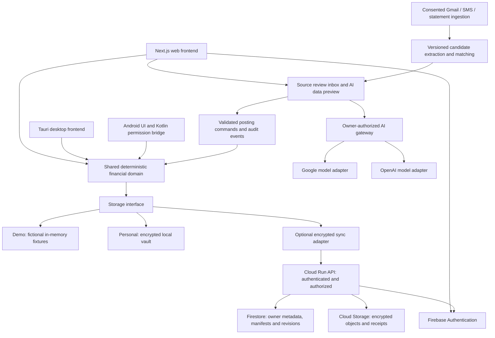

**Finance Atlas implementation and product plan — 11 November 2026**

This is a proposal, not deployed infrastructure. No Firebase service, OAuth client, Analytics integration, model endpoint, Gmail connection, or SMS permission was created or enabled during this review. The supplied Firebase snippet identifies a registered web app; it does not prove which project services or billing options are currently enabled. The public client API key is not reproduced here.

**1. Recommended product direction**

Develop Finance Atlas as a private finance workspace with reliable reconciliation and understandable goal planning. Its strongest initial outcome is helping someone understand where money went and what obligations remain before the next salary. Measure that outcome before expanding to autonomous agents, stock recommendations, or multiple cloud platforms.

Maintain three distinct product modes:

| Mode | Data and identity | Available features |
|---|---|---|
| Public showcase | Fictional fixtures in memory, no account or personal import | Edit demo transactions, view budgets, resolve simulated duplicates, replay goal scenarios, reset |
| Personal local app | User's encrypted local vault and explicit exports | Existing finance workflows, imports, local parsing, optional attended Gmail sync later |
| Private cloud pilot | Invited identities with individually authorized storage | Opt-in encrypted sync and separately consented AI/connectors |

The public showcase must not be a route inside an already unlocked personal workspace. Build it with a memory-only storage adapter, no cloud credentials, no real file/inbox connectors, no raw-data logs, and a visible Fictional demo badge. Reset destroys the in-memory fixture. Reload starts a new demo. Browsers can still cache app assets and hosting infrastructure can retain request/IP logs; describe the promise as no financial data/account required, not literally zero data processing everywhere.

**2. Target system design**



Keep financial calculations in tested application code. An LLM can suggest a category or explain a scenario, but must not become the balance calculator, authorization mechanism, or source of market prices. Start with the existing TypeScript backend and shared domain. Add a small Python document-processing worker only when a measured PDF/OCR requirement justifies it. A modular backend is sufficient; microservices, Kubernetes, and a multi-agent platform are unnecessary for the initial personal workload.

Use a simple provider interface for Google and OpenAI: input schema, allowed task, redacted context, output schema, timeout, token limit, cost reservation and usage result. Model IDs belong in a server allowlist, with provider/model selection in Settings. Do not silently switch providers, since that changes who receives data. Consider LangGraph only when there is a real need for durable branching, checkpoints, retries and human approval; deterministic import jobs do not require agents.

**3. Phased work with acceptance gates**

Times are indicative for part-time development, not delivery commitments. Keep the scope of the first month to foundation, showcase and a tested private sync pilot; public Gmail verification and investment advice are separate workstreams.

| Stage | Work | Gate before proceeding |
|---|---|---|
| Foundation: week 1 | Split financial domain from UI/storage, version import schemas, preserve existing extensions, idle auto-lock, error boundaries, reconciliation fixtures | Restoring an old backup preserves records; transfers/repayments do not create extra expense; corrections keep history |
| Showcase: week 2 | Memory-only demo build, fictional statements/messages, guided scenarios, reset, accessibility and keyboard pass | No IndexedDB/localStorage financial writes, connector calls, personal fixtures, cloud SDK initialization, or finance payload logs in demo |
| Identity and private sync: weeks 3–4 | Firebase Google sign-in, owner API access, encrypted object manifests, retries/conflicts, tested recovery, redacted telemetry | Two devices can edit offline and resolve a conflict without silent overwrite; unauthorized identities cannot access another vault; restore succeeds on a clean profile |
| Import automation: weeks 5–6 | Bank CSV/PDF formats, source review inbox, parser versions, linking and duplicate resolution, attended Gmail OAuth pilot | A real held-out corpus has measured extraction and matching errors; rejected candidates never post automatically |
| Goal planning and AI: weeks 7–8 | Debt/travel/home scenarios, controllable assumptions, provider selection, payload preview, budget controls, model evaluations | Same inputs produce the same financial calculations; AI cites the calculation inputs; no unapproved ledger mutation |
| Android pilot: weeks 9–12 | Native permissions/Keystore, share/import flow first, SMS eligibility review, opt-in parsing, background scheduling | Denial/revocation leaves manual workflows usable; nonfinancial SMS/OTPs are excluded; device/Play distribution checks pass |
| Commercial readiness: after evidence from testers | Independent security assessment, privacy/legal review, signed releases, support/restore process, pricing tests | Paying users understand the product, retention is demonstrated, ongoing support and compliance costs are funded |

**4. Next stages for the registered Firebase app**

Do not paste the complete sample into the current entry point. In particular, importing `getAnalytics` is unnecessary for login or sync and would change the current privacy posture. Do not install/initialize Firebase in the offline desktop or demo build merely because a web registration exists.

The next implementation change should add environment-specific, lazy initialization behind an explicit cloud-mode setting. Use the registered personal project for the private pilot and a separate environment for future testers. The fictional showcase should have no database connection at all.

When implementation is authorized:

1. Verify the intended project, billing account, remaining trial credit and database region. Create project-specific budgets before enabling chargeable products.
2. Enable Google sign-in, implement the sign-in UI, sign in as the owner, and configure the pilot backend with the resulting owner UID. A successful Google sign-in alone does not imply authorization to any vault.
3. Keep the current deny-all Firestore client rules for the server-mediated design. The Admin SDK bypasses these rules; server authorization and least-privilege IAM must therefore enforce ownership. App Check is supplementary abuse protection for supported clients, not user authorization.
4. Fix the pilot backend dependency advisories. Connect the web client only after token expiry, revocation, forbidden-user and conflict tests pass. Desktop Google OAuth needs the system browser and an approved callback/session handoff; do not assume a Google login page can be embedded inside WebView2.
5. Use Firestore for compact manifests and revision metadata. Move large encrypted vault chunks and receipts to scoped Cloud Storage objects. Verify object hashes before committing a manifest, and garbage-collect abandoned uploads without deleting referenced revisions.
6. Add AI through Cloud Run, a runtime service identity, and provider adapters. Store the OpenAI key and OAuth client secret in Secret Manager. Keep them out of browser configuration. Select the current available Google model/region at implementation time.
7. Test everything with fictional data, then explicitly opt the personal vault into sync. Retain independent encrypted backups.

Firebase API keys identify a project and are public client configuration. Apply appropriate API restrictions and use separate credentials for non-Firebase products; authorization still depends on IAM/rules/application checks. [Firebase API key guidance](https://firebase.google.com/docs/projects/api-keys).

For the earlier ₹1,000/month target, use scale-to-zero/request-based services, bounded storage retention, a small model, on-demand insights and a server-enforced application usage budget. Allocate an initial target of roughly ₹300 infrastructure, ₹500 model usage and ₹200 contingency/taxes, then replace it with measured costs. These are allocations, not quotes or hard billing caps. Direct OpenAI usage has separate billing; verify which Google products the trial actually covers. Public connector security assessments, certificates, market-data licensing and support can exceed this personal budget.

**5. Gmail: two integration options and their privacy implications**

Firebase Google sign-in establishes identity. Gmail requires a separate explicit OAuth authorization. Use the official Gmail API, not a Gmail password, UI automation or inbox scraping.

First implement attended sync while the app is open/unlocked:

1. Configure Gmail API access and OAuth consent in the intended project when this work is authorized. Add the owner as a test user for a personal pilot.
2. Request the least scope that actually supports extraction, normally `gmail.readonly`; reading transaction bodies cannot be achieved by identity-only scopes. Explain why access is requested and provide disconnect/revoke controls.
3. Bound the initial import by date and eligible bank/merchant messages. Optional Gmail labels and sender/date queries reduce what the app processes; they do not narrow the OAuth scope itself. Avoid extra modify scopes just to label messages.
4. Retrieve message IDs and required content, safely decode MIME, ignore unrelated messages and do not render untrusted email HTML. Never follow embedded email links or execute document instructions.
5. Produce candidates and compare them against existing entries. Save a source reference/hash and parser version. Commit only through the review/posting pipeline.
6. Save an incremental history cursor after successful processing. Recover from stale Gmail history IDs with a bounded rescan and idempotent matching. Show sync errors, last successful sync, and what changed.
7. Revoke OAuth tokens and delete retained connector data on disconnect, according to the chosen retention policy.

`gmail.readonly` is a restricted scope. Public use requires the applicable OAuth verification, and restricted data stored or transmitted through servers can trigger a security assessment. Personal/testing exceptions must be checked against the actual use case. External OAuth apps in Testing that request Gmail access normally receive refresh tokens that expire after seven days. [Scopes](https://developers.google.com/workspace/gmail/api/auth/scopes), [verification](https://developers.google.com/identity/protocols/oauth2/production-readiness/restricted-scope-verification), [token lifetime](https://developers.google.com/identity/protocols/oauth2).

For unattended twice-daily sync, a browser tab cannot guarantee execution when closed. A later Cloud Scheduler → private Cloud Run job can fetch using a securely stored refresh token. This means the server processes selected Gmail data in readable form. The alternative is device-side processing when the desktop/mobile app is available. Decide between these deliberately.

An encrypted vault with a passphrase unavailable to the backend cannot be edited by an unattended server. One possible design is a separate encrypted candidate inbox: process eligible messages transiently, encrypt candidate results to a device/public recipient key using a reviewed encryption library, and merge them only when the user unlocks. This preserves the vault-key boundary but does not mean the Gmail ingestion server never saw readable source data. Do not store the vault passphrase on the server to make scheduling convenient.

For twice-daily use, polling plus incremental history is simpler than push. Gmail push adds Pub/Sub and watch renewal; watches must be renewed at least every seven days. [Incremental synchronization](https://developers.google.com/workspace/gmail/api/guides/sync), [push notifications](https://developers.google.com/workspace/gmail/api/guides/push).

**6. SMS: platform capabilities**

| Platform | Practical approach |
|---|---|
| Web/PWA | No general access to the SMS inbox. Accept user-shared text, supported files or statements. OTP APIs do not provide general transaction history. |
| Windows Tauri | No phone inbox access by default. Import selected messages/files or later sync approved candidate events from an Android companion. |
| Android | Start with share-to-app/paste/file import. Later use a Kotlin permission/ingestion bridge, with explicit consent, only if the distribution policy permits SMS-based money management. |
| iOS | Do not promise Android-style inbox ingestion. Apple's message-filter extensions are constrained and are not a general historical finance-inbox reader. |

On Android, historical access can require READ_SMS; new-message handling can require RECEIVE_SMS. Play treats these as restricted permissions. SMS-based money management is a listed exception, but approval is case-by-case and the permission must be essential to the app's core function. A sideloaded personal build still needs user permission and must handle revocation. Do not make the app a default SMS handler unless it really implements that role. [Google Play SMS policy](https://support.google.com/googleplay/android-developer/answer/10208820?hl=en).

After permission, process supported financial senders on-device, exclude OTPs and personal conversations, normalize multipart messages, record source IDs/hashes and enqueue encrypted candidates. Avoid notification-listener or accessibility access as a shortcut around SMS policy. Use Android Keystore for device secrets and WorkManager for best-effort periodic processing, not exact-time guarantees. [Android scheduling](https://developer.android.com/reference/androidx/work/PeriodicWorkRequest), [Apple limitations](https://developer.apple.com/documentation/identitylookup/sms-and-mms-message-filtering).

**7. Automatic mapping and verification**

Use one pipeline for email, SMS, CSV and PDF. An alert is evidence to review, not proof that a transaction settled. Final reconciliation should use authoritative statement rows, opening/closing balances and explicit user confirmation.

```text
Source event → sanitized extraction → normalized candidate
             → exact/source duplicate detection
             → account, amount, date, reference and event-type matching
             → review or narrowly opted-in automatic approval
             → validated ledger command → audit event → reconciliation
```

Proposed records:

| Record | Important fields |
|---|---|
| SourceEvent | user/source ID, provider message ID or file/row hash, received time, source time zone, parser version, encrypted evidence reference, retention deadline |
| Candidate | amount in minor units, currency, debit/credit, event type, masked account hints, transaction date, posted date, merchant, reference, extraction confidence |
| MatchDecision | linked transaction/occurrence/statement IDs, matching confidence and reasons, reviewer, decision timestamp, rejected/merged status |
| LedgerTransaction | immutable posted amounts, explicit account legs, source links, original IDs, corrections/reversal links |
| GoalScenario | goal amount/date, priority, protected expenses, assumptions, starting balances, calculation version |
| AiRun | provider/model, task/prompt version, redaction policy, context hash, result schema, token usage, user approval; no raw inbox logs |

Deduplicate the same financial event across Gmail, SMS and statements using reference, account, direction, amount and date windows. Equal amounts alone are insufficient. Handle card purchases separately from repayments, bill reminders separately from debits, transfers as two linked account movements, refunds/reversals separately from income, pending/failed transactions, fees/interest, forex and partial/split payments. Account last-four hints can be ambiguous and must trigger review.

Initially send every candidate to a review queue. Later permit narrow rule-based approval only for measured, well-understood cases and user-selected accounts. LLM confidence scores are not calibrated settlement verification. Test against unseen bank formats, adversarial documents, duplicate deliveries and parser-version changes. Show proposed, confirmed, statement-matched and disputed states distinctly.

PDF parsing must be sandboxed/bounded, respect file/expanded-size limits, reject active content, and support password-protected files without retaining the password. OCR is a fallback, with clearly visible uncertainty. Start with a small declared set of bank formats rather than claiming universal statement support.

**8. Goal and theme-based insights**

Represent debt payoff, emergency fund, a house, travel, and shared events as explicit goal scenarios. A goal needs a target/date, priority, protected essentials, minimum debt payments and user-controllable assumptions. Tags/groups should track planned costs, actual cash spend, outstanding commitments, reimbursements and shared responsibility separately.

Compute the baseline from salary-cycle cash flow and actual obligations, then compare scenarios. Example: a user chooses to reduce dining by ₹2,000 and subscriptions by ₹500; the engine calculates the change in available cash and a debt timeline using verified balances/rates. The AI explains the result, identifies assumptions and offers alternatives. It must not invent a precise debt-free date when APR/principal is unknown, count expected reimbursements as received, or describe budget estimates as guaranteed savings.

Use sliders and before/after charts with an explanation of included records. Cache an insight against the ledger/scenario version and invalidate it when the source changes. Keep forecasts probabilistic or scenario-based when income, interest rates or investment returns are uncertain.

**9. Portfolio tracking versus investment recommendations**

Build holdings import, transactions, cost basis, dividends, fees, benchmark comparisons and user-directed allocation tracking first. Use timestamped, licensed data and reproducible performance calculations, with clear stale-price handling. An LLM is not the market-data source. Market/news retrieval adds provenance, licensing, caching and model-evaluation requirements.

For private use, explore educational scenarios around risk, time horizon and diversification. A public feature that recommends particular mutual funds/stocks, allocations or buy/sell actions based on personal goals requires a separate regulatory and suitability review. In India, personalized investment advice and securities research recommendations may engage SEBI IA/RA rules; calling the output AI-generated or free does not by itself resolve those obligations. Obtain professional advice before offering that feature to others. [SEBI investment adviser guidance](https://investor.sebi.gov.in/investment_advisor.html), [SEBI research analyst guidance](https://investor.sebi.gov.in/research_analyst.html), [regulations index](https://www.sebi.gov.in/sebiweb/home/HomeAction.do?doListing=yes&sid=1&ssid=3).

Avoid a news-driven stock picker as the initial differentiator. First demonstrate trustworthy reconciliation, debt planning and explainable cash-flow forecasts. Keep order execution and financial-product commissions out of the initial release.

**10. Sharing and selling**

Publish a fictional demo on a separate origin/build. Never upload the developer's vault, receipts, snapshots, `.env`, service-account files or real financial screenshots. Test the final downloadable artifact in a clean Windows account/profile. Ship installers without a prepopulated personal database. Use distinct app IDs for a separate showcase desktop build so it cannot open an installed personal profile.

Before public downloads, add signed releases, build checksums, dependency/SBOM review, a clear privacy policy, consent flows and documented backup/restore. Test the ARM64 and x64 editions independently. The current build is ARM64 and unsigned. Google Play permission approval and OAuth verification are not supplied by having a Firebase project.

For monetization, validate one target segment first: salaried people juggling cards/EMIs, households sharing event budgets, or freelancers reconciling payments. Interview prospective users and measure activation, import accuracy, weekly use, correction rate and willingness to pay. A local-only paid desktop edition or paid planning/export features can precede managed cloud connectors. Sync, connector verification, market-data licensing and support have recurring costs that need a sustainable subscription or separate pricing. Selling personal financial/inbox data should not be the business model.

Before processing real tester/customer data, establish user isolation, deletion/export, consent/retention, incident response, processor terms and applicable privacy-law obligations. India's DPDP framework and commencement/transition rules need review for the launch date and service design. [MeitY DPDP material](https://www.meity.gov.in/static/uploads/2025/11/53450e6e5dc0bfa85ebd78686cadad39.pdf). Treat this as a release workstream rather than a claim that this review supplies legal clearance.

**11. Gaps found in the current implementation**

This is a code/configuration review and functional-test update, not a penetration test or certification.

| Priority | Evidence/current limitation | Required action |
|---|---|---|
| Before public pilot | Frontend uses local IndexedDB; API hard-codes one authorized owner and one vault reference | Separate fictional demo from personal app; design per-user authorization before accepting tester data |
| Before sync | API accepts 512 KiB ciphertext; local vault allows 30 MB and attachments | Object/chunk sync with committed manifests, integrity checks, conflict UI and tested restores |
| Before cloud | Backend audit on this review found 6 moderate transitive advisories, 0 high/critical | Update and regression-test supported dependencies; audit again before deployment |
| Before personal unattended use | No idle auto-lock or OS-lock/background policy was found | Clear in-memory keys after an explicit idle/lock policy; test dialogs and unfinished operations |
| Before automation | CSV reconciliation exists, but no Gmail/SMS source-event inbox, connector consent, cursors or source-level deduplication | Build the provenance/review pipeline before auto-posting |
| Before public demo | No memory-only showcase adapter or synthetic-only release boundary | Add explicit demo build and storage/network tests; disable personal import/connectors there |
| Before large imports | Vault writes clone, validate and encrypt the full ledger; receipts are embedded | Measure realistic volumes and save latency; move parsing into workers and attachments into encrypted objects when justified |
| Before broad distribution | ARM64-only build, unsigned installer, no tested signed update/rollback pipeline | x64 build, signing and artifact provenance; safe update strategy with backup compatibility |
| Before cloud/AI | Desktop CSP intentionally blocks external connections; SDK/Auth/AI are not wired | Explicit, separate opt-in cloud mode and endpoint allowlist; preserve offline-only default |
| Before multi-device use | Whole-snapshot revision conflict detection is present, automatic merging is not | Define conflict semantics for financial records; preserve both edits, never silently last-write-wins balances |
| Before advice/planning claims | No holdings ledger, licensed price/news feed, suitability or model evaluation infrastructure | Build reproducible tracking/scenarios and evaluate model outputs before securities recommendations |
| Product quality | Domain/UI/storage responsibilities remain concentrated in large modules | Extract domain/application/adapters incrementally with compatibility tests; avoid a rewrite that breaks imports |
| Operational readiness | Backups/reminders require app open/unlocked; no restore SLO, support process or redacted production metrics | State the limitation, measure backup freshness and recovery, add failure notifications and runbooks |
| UX quality | Navigation is view state rather than URL routing; limited deep links and no review inbox | Add shareable non-sensitive routes, unsaved-form handling, command palette, guided import and useful empty/error/loading states |

Privacy-mode blur is a visual convenience, not access control. A lost passphrase currently has no recovery escrow; offer deliberate recovery options without undermining encryption. Follow a documented web/mobile security baseline such as [OWASP ASVS](https://asvs.owasp.org/) and [MASVS](https://mas.owasp.org/MASVS/), and record which controls have actually been tested.

**12. Strong portfolio extensions and adjacent products**

These are product hypotheses to validate, not established market-demand claims. RBI reporting shows continuing consumer-service issues across loans, credit cards and digital banking, which supports investigating reconciliation and dispute workflows. It does not prove willingness to pay for any proposed app. [RBI Ombudsman report](https://www.rbi.org.in/scripts/PublicationsView.aspx?id=23441).

| Project/use case | User problem | Engineering depth and evidence to show |
|---|---|---|
| Refund and dispute tracker | A return is approved but the credit never arrives | Cross-source event matching, SLA timers, evidence pack, no automated bank complaint without approval; measure false matches |
| Freelancer payment reconciliation | Invoice, partial payment, bank settlement and fees disagree | Idempotent ingestion, split allocation, accounting invariants, correction audit and reconciliation reports |
| Household/event cash planning | Travel/shared expenses obscure who owes what and when cash is needed | Offline collaboration, conflict resolution, shared/private permissions, reimbursements distinct from income |
| Insurance/warranty claim organizer | Documents and deadlines are scattered | On-device extraction, policy/receipt links, retention, renewal/claim checklists; avoid claiming policy advice |
| Private document-to-ledger engine | Bank formats change and unsafe PDFs break imports | Sandboxed parsing, golden corpus, parser versioning, provenance, replayable migrations, adversarial tests |
| Developer data-import reliability toolkit | Teams struggle with duplicates, retries and unexplained reconciliation errors | Reusable typed ingestion SDK, idempotency keys, OpenTelemetry with redaction, replay UI and load/fault tests |

For a job/technical-manager audience, one well-explained system with measurable reliability is more persuasive than several unfinished frameworks. Publish an architecture diagram, decision records, threat model, synthetic demo, migration design, benchmark methodology and a short incident/failure walkthrough. Show a difficult tradeoff honestly: privacy versus unattended ingestion, deterministic arithmetic versus probabilistic extraction, and offline edits versus financial consistency.

Use TypeScript/React and Rust where the project already benefits from them; Kotlin for Android-specific permissions; Python only for measured OCR/parser needs. Learn a durable workflow engine such as Temporal or LangGraph by implementing a justified checkpoint/approval use case after the basic pipeline is reliable. Use OpenTelemetry for sanitized traces and Playwright/native integration tests for evidence. Do not add a queue, vector database, Kubernetes cluster or many agents solely to make the architecture look advanced.

Suggested portfolio milestones: reproducible synthetic import corpus with labeled errors; zero duplicate postings under replay; recoverable two-device conflict demonstration; a fresh-profile encrypted restore; strict owner-access tests; accessible mobile demo; and a measured per-insight cost. Report observed results and limitations rather than target numbers presented as achievements.
