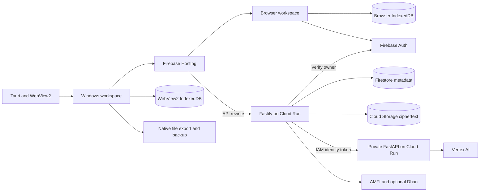

# Finance Atlas 0.2.1 project analysis

Reviewed the `dev` checkout at `71e495d` on 23 November 2026. Finance Atlas is a local-first personal finance workspace for one owner. Its strongest boundary is that the device owns the ledger and its passphrase. Optional cloud services add encrypted snapshot sync, desktop sign-in, market data, and AI. The most consequential gaps are recovery coverage for device-only records and reproducible verification of the deployed cloud path.

The follow-up [live deployment audit](live-deployment-audit-0.2.1.md) verifies public Hosting and API responses, mobile rendering, and browser performance against the deployed build.

## Architecture and product

| Surface | Responsibility | Source |
| --- | --- | --- |
| Dashboard and navigation | Cash and card position, period KPIs, spending mix, budget, due items, recent activity, and goals. Entries link to detailed views. Search, compact navigation, theme, and motion preferences span the workspace. | [Dashboard](../../app/overview.tsx), [shell](../../app/shell.tsx), [navigation](../../lib/navigation.ts) |
| Recording and reconciliation | Entries, card statements and payments, CSV review, transfer matching, receipts, corrections, and balance confirmations. Reports include printable, CSV, and audit workbook exports. | [Transactions](../../app/transactions.tsx), [statements](../../app/statements.tsx), [records](../../app/records.tsx), [files](../../lib/files.ts), [reports](../../lib/reports.ts) |
| Planning and assets | Bills, insurance, subscriptions, EMI and personal lending, budget, calendar, salary funding, goals, forecasts, debt, tax, investments, and vehicles. The tax calculator explicitly limits supported years and income. | [Planning](../../app/planning.tsx), [asset views](../../app/assets.tsx), [asset calculations](../../lib/assets.ts) |
| Documents | Local CSV and PDF extraction, password prompts, hints, and statement matching. Verified CSV posting is opt-in. Originals are encrypted on the importing device. | [Document UI](../../app/documents.tsx), [parsers](../../lib/documents.ts) |
| Attention and Assistant | Local summaries plus optional cloud specialists and chat. Chat has a full-page view and drawer. Cloud turns require a preview and one-turn consent. Policy research and quotes are separate flows. | [Attention](../../app/attention.tsx), [Assistant](../../app/assistant.tsx), [local facts](../../lib/assistant.ts) |
| Desktop | Windows bundle embeds the same export in WebView2. Tauri provides native exports, backup folder selection and atomic writes, theme, safe external links, and browser-to-desktop pairing. | [Native commands](../../src-tauri/src/lib.rs), [pairing](../../src-tauri/src/cloud_auth.rs), [desktop config](../../src-tauri/tauri.conf.json) |

### UI and performance

The dashboard organizes a large feature set around an overview and more focused screens. The existing use of labeled icon buttons, pressed states, keyboard shortcuts that ignore active form inputs, live save/error announcements, and reduced-motion styling gives the UI a useful foundation. Transactions paginate their results, and PDF.js is loaded on demand for extraction. [Dashboard](../../app/overview.tsx), [workspace](../../app/page.tsx), [transactions](../../app/transactions.tsx), [PDF extraction](../../lib/documents.ts).

- `app/feature-ui.tsx:48` — The shared native dialog has a visible heading without a programmatic label. Connect it to the dialog and verify the spoken title, focus entry, and focus return.
- `app/page.tsx:421`, `app/shell.tsx:13` — Section navigation and the selected card live in React state and an internal history stack. Reload starts over, and browser Back cannot step through sections. Use a stable route or fragment for non-sensitive state if durable navigation is needed.
- `app/page.tsx:529` — The shell lacks a skip link to the main content. Test keyboard navigation through the sidebar and mobile drawer before release.
- `app/polish.css:206`, `app/overview.tsx:68` — Hide amounts blurs text, while exact chart figures remain in accessible names. Treat it as a visual convenience in its current form. If the intent is to conceal values for screen-reader and screen-sharing users, suppress sensitive labels and chart values at render time.
- `app/workspace.css:18`, `app/attention.tsx:210` — At 390 px, the fixed Assistant launcher partially covers the Documents button when the attention panel reaches the bottom of the viewport. Reserve room for the launcher or relocate it when it overlaps a control. The desktop capture also shows it covering part of a spending category amount.
- `app/assistant.tsx:205` — Clear chat immediately replaces the local transcript with an empty history. Add confirmation or undo for this action.
- `app/page.tsx:21`, `app/overview.tsx:21` — Eager imports pull multiple feature screens into the main route, and dashboard renders recalculate multiple ledger summaries. The build produced several large JS chunks, with a largest raw chunk of about 470 kB. Measure route transfer size and render latency with a large synthetic ledger before splitting by feature or introducing shared indexes for repeated calculations.

## Ledger, persistence, and imports

Money is stored in integer paise. The client calculates balances, budgets, and obligations from the ledger. Its save path clones the current ledger, applies the command, validates it, checks settled history, appends an audit record, and saves against the expected revision. Card repayments and transfers move balances without counting as new spending. Reversal entries preserve financial history, and past EMI amounts remain distinct from changed future schedules. Calendar periods and salary cycles use the same domain functions across screens. [Ledger](../../lib/ledger.ts), [finance rules](../../lib/finance.ts), [save path](../../app/page.tsx#L346).

| Data | At rest and recovery |
| --- | --- |
| Ledger, settings, and embedded receipt bytes | AES-256-GCM envelope in the IndexedDB `workspace` store. PBKDF2-SHA256 uses 600,000 iterations. A save compares the previous UUID revision. Plaintext vault cap is 30,000,000 bytes. |
| Local recovery and folder backups | IndexedDB retains up to 25 encrypted snapshots. Browser folder writes depend on permission and browser support. Desktop uses a user-selected folder and atomic writes. Automatic backups run while the workspace is open and unlocked. |
| Document originals, extracted text, review state, and chat | Separate encrypted IndexedDB `deviceRecords` namespace keyed by the vault salt. Excluded from the portable ledger backup and encrypted cloud snapshot. |
| Local preferences | IndexedDB stores app preferences, including backup settings and the local cloud sync base. The lock-screen theme also uses localStorage. |
| Cloud snapshot | Firestore `atlasCloud/{uid}` holds the head and daily analysis counter. Snapshot and pairing subcollections hold metadata and short-lived tickets. Cloud Storage holds ciphertext keyed by owner, revision, and digest. The legacy fallback keeps a smaller envelope in `atlasVaults/{uid}`. |
| AI accounting | Firestore `atlasAiUsage/{uid}` stores monthly counters and run metadata. Cloud prompts and facts are sent to the worker for inference. Desktop and browser retain their own chat history. |

CSV imports review date formats, duplicates, classification, and links to existing records. Unknown legacy fields are retained where the importer supports them. Plaintext JSON, CSV, ZIP, and XLSX exports cross the vault boundary and should be distinguished from an encrypted backup in the UI. The browser and Windows app keep separate vaults. [Vault](../../lib/vault.ts), [file formats](../../lib/files.ts), [backup controls](../../app/backup.tsx), [desktop migration](../DESKTOP.md).

## API, middleware, and external services

Next.js has a static export with `/` and `/connect/`. The request boundary is Firebase Hosting rewrites plus Fastify hooks, with no Next.js server middleware in the checkout. Fastify sets `Cache-Control: no-store`, limits request sizes and rates, and permits desktop CORS only for the known Tauri origins. Protected routes verify a Firebase token with revocation checking and require the configured owner UID. The public health probe and desktop exchange serve different purposes. The latter depends on a challenge-bound, single-use, two-minute ticket issued to an authenticated owner. [Hosting](../../firebase.json), [API hooks](../../api/app.mjs), [API startup](../../api/main.mjs), [desktop exchange](../../api/cloud-routes.mjs).

| Route | Behavior |
| --- | --- |
| `GET /health`, `GET /healthz` | Process health. Hosting exposes `/health`. |
| `GET /v1/sync/head` | Returns the current revision, salt, IV, digest, and size, or an empty head. |
| `GET /v1/sync/snapshots/:revision` | Returns binary ciphertext after server verification. The client verifies size and digest again. |
| `PUT /v1/sync/snapshots/:revision` | Accepts ciphertext and expected-head, salt, and IV headers. Uses immutable storage creation and a Firestore transaction. Returns a conflict for a stale base and accepts a matching revision replay. |
| `POST /v1/auth/desktop/issue`, `POST /v1/auth/desktop/exchange` | The owner requests a ticket in the system browser. The desktop exchanges it with the original verifier and uses the resulting Firebase custom token. |
| `GET /v1/vault`, `PUT /v1/vault` | Legacy JSON envelope routes used when the binary sync bucket is absent. The current client expects the binary sync head for its cloud connection flow. |
| `GET /v1/ai/models`, `GET /v1/ai/usage` | Model catalog and run accounting. The models route has a disabled response when cloud AI is off. |
| `POST /v1/ai/analyze`, `POST /v1/ai/chat`, `POST /v1/ai/policy` | Opt-in attention analysis, approved chat turns, and optional public policy research. Availability depends on deployment configuration. |
| `POST /v1/market/quotes` | Owner-only lookup for up to 25 instruments. AMFI supplies mutual fund NAV. Dhan supplies optional equity and ETF quotes. Missing quotes are omitted. |

The sync client remembers a common revision and asks which copy to keep when devices diverge. It creates encrypted recovery copies before resolving a conflict. The service stores the object before atomically advancing the revision metadata. Cloud analysis sends a small typed set of facts and filters proposals against submitted item IDs and values. Cloud chat has a broader consent surface because its payload contains the user's question and recent conversation text. Its preview makes those fields visible. The API reserves an estimated cost transactionally, and the worker runs bounded calls to Vertex AI. Keep analysis, chat, policy research, and quote lookups distinct when evaluating privacy. [Sync client](../../app/attention.tsx), [snapshot store](../../api/cloud-store.mjs), [assistant API](../../api/assistant.mjs), [worker](../../agent/main.py), [worker chat and research](../../agent/assistant.py), [market feeds](../../api/market.mjs).

## Deployment and operations

Firebase serves `out/` with security headers and immutable caching for hashed Next.js assets. The public Cloud Run API checks app-level identity, and the worker's Cloud Run IAM policy should permit invocation only by the API service identity. Firestore rules deny direct client reads and writes. The pilot targets Mumbai, while Vertex routing and data handling depend on the configured model location. Public Firebase settings are embedded at frontend build time. The desktop build reuses those values and adds the configured Hosting origin to its CSP for cloud-enabled builds. [Pilot runbook](../CLOUD-PILOT.md), [Firestore rules](../../firestore.rules), [desktop build](../../scripts/desktop.mjs).

- **Promotion and rollback.** The checkout provides Dockerfiles, lockfiles, and a manual deployment runbook. It has no tracked CI workflow, infrastructure definition, or deployment environment manifest that proves which commit and service revisions are live. Pin the release tooling and record the built commit, web release, API and worker revisions, and Windows installer checksum and signing status together. Exercise rollback in staging.
- **Cloud limits.** The 30 MB binary envelope sits near Cloud Run's 32 MiB HTTP/1 request limit. The API holds the snapshot in memory, and the pilot caps API instances without specifying concurrency. Measure concurrent transfer memory and test near-limit uploads and downloads through Hosting and Tauri. The documented 45-second worker and 55-second API timeouts sit within Hosting's 60-second deadline. Measure cold starts and confirm useful errors. [Cloud Run limits](https://docs.cloud.google.com/run/quotas), [Firebase Hosting and Cloud Run](https://firebase.google.com/docs/hosting/cloud-run).
- **Storage lifecycle.** Committed cloud versions are retained, and a storage write can succeed before a concurrent head update loses the Firestore compare-and-set. That leaves an object without committed metadata. Define retention for both cases, protect the head and retained backups, and audit costs. Verify a TTL policy for expired pairing documents. The API checks expiry independently of cleanup.
- **Observability.** The public probe reports process liveness. The application disables Fastify logging and suppresses worker access logs. Add status, latency, dependency errors, revision conflicts, and usage reconciliation metrics with request IDs. Keep tokens, plaintext finance, prompts, and documents out of operational logs.
- **Supply chain.** Node lockfiles and the Cargo lockfile support repeatable dependency resolution. The worker only declares a pinned ADK and ranged GenAI dependency while importing FastAPI, Pydantic, and Uvicorn directly. Declare direct dependencies and lock the worker environment. Build and test using Node 24, Python 3.12, and the repository's supported Rust toolchain.

## Priority follow-ups

| Priority | Finding | Acceptance evidence |
| --- | --- | --- |
| High | **Device data can become inaccessible after choosing an unrelated cloud vault.** Using the cloud copy changes the salt-derived device-record scope and key. Earlier encrypted document and chat records remain under the prior scope. Ledger recovery and folder backups omit those records. | Use two fictional vaults with different salts. Verify clear disclosure before switching and a way to export and recover the device library with its original key. [Restore](../../app/page.tsx#L382), [device scope](../../app/page.tsx#L522), [device record storage](../../lib/vault.ts#L27) |
| High | **Cloud readiness depends on manual verification.** Service authorization, deployed rewrites, desktop OAuth, storage IAM, and actual snapshot limits can drift independently of the checkout. | A staging release verifies anonymous and non-owner denial, private worker IAM, owner sign-in and pairing, near-limit transfer, two-device conflict recovery, and rollback. [Pilot checks](../CLOUD-PILOT.md#verify-before-loading-your-finance-history) |
| Medium | **Rate limits and storage lifecycle need deployment evidence.** The Fastify limiter is in-process, and the source has no proxy-aware identity configuration. Pairing expiration is enforced in code, while cleanup policies are external. | Confirm effective request identity through Hosting and direct Cloud Run, protect endpoint traffic appropriately, and verify lifecycle policies for expired tickets and unreferenced snapshot objects. [API middleware](../../api/app.mjs#L27), [store](../../api/cloud-store.mjs#L3) |
| Medium | **Privacy display and accessible names diverge.** Exact values remain accessible while their visual representations are blurred. | Exercise Hide amounts with keyboard navigation and a screen reader. Verify chart labels, text, and progress values follow the intended visibility rule. [Chart markup](../../app/overview.tsx#L68), [masking styles](../../app/polish.css#L206) |
| Medium | **The one client route carries many features.** Changes to workspace state can cause broad rendering and computation. | Profile initial load, vault unlock, search, and period changes using a large fictional ledger. Use the timings to prioritize feature-level loading and shared derived summaries. [Workspace entry](../../app/page.tsx), [dashboard](../../app/overview.tsx) |
| Medium | **Failure handling and release evidence are uneven.** Provider failures can appear as missing quotes, and request logs and release automation are limited. | Document partial provider failure in the UI, validate worker startup from its locked container environment, and record environment-scoped test results with each release. [Market route](../../api/market.mjs), [worker dependencies](../../agent/requirements.txt) |

## Baseline and method

The six [OpenSpec baselines](../../openspec/specs/) capture current behavior for the ledger, workspace UI, vault recovery, cloud access and sync, Assistant and feeds, and deployment. Runtime gaps belong in follow-up proposals. The [OpenSpec Explore workflow](https://github.com/Fission-AI/OpenSpec/blob/main/docs/explore.md) guided the source review and the OpenSpec CLI checks the requirements and scenario format.

GitSpec 1.1.7 ran its local `parse` command on an archive of the tracked `dev` commit and reported 143 parsed files. The dependency graph supported the analysis of the shared TypeScript modules and client feature entry points. The published CLI's full generator requires LLM and embedding configuration. No GitSpec generation or external upload of the checkout was performed. The API, Python worker, Rust, deployment, and product analysis came from reading and checking their sources directly. The package's own README supplied the model configuration requirements. [GitSpec package](https://www.npmjs.com/package/git-spec/v/1.1.7).

The UI review used the skills.sh [Web Interface Guidelines](https://skills.sh/vercel-labs/agent-skills/web-design-guidelines) and [Vercel React Best Practices](https://skills.sh/vercel-labs/agent-skills/vercel-react-best-practices).

## Verification

| Check | Result |
| --- | --- |
| `npm.cmd test` | 43 passed. Six comparisons skipped because the legacy HTML fixtures were absent. |
| `npm.cmd test` in `api/` | Eight passed using the test store and injected identity and worker dependencies. |
| `py -m unittest -v test_specialists.py` in `agent/` | Two passed on the installed Python 3.14. These test specialist orchestration without model calls. The container uses Python 3.12. |
| `npm.cmd run build` and `npm.cmd run check` | Production static export and TypeScript check passed on local Node 25.8.1. Use Node 24 for release parity. |
| `npm.cmd run test:browser` | Passed on isolated headless Chrome using the production export and fictional records. Covered dashboard and all views at desktop and mobile widths, ledger and payment flows, encrypted restore, reload, stale-write protection, and the absence of app exceptions and unexpected outbound requests. Visually reviewed the 1440 px and 390 px dashboard captures and the desktop Assistant capture. |
| `openspec validate --specs --strict` | OpenSpec 2.1.1 accepted all six baselines. |
| Native tests and install | This run found Cargo 1.84. The manifest targets Rust 1.90 and edition 2024, so Cargo stopped before running the native suite. WebView2 runtime and installer signing were unverified here. |
| Deployed services | Live OAuth, Windows pairing, owner IAM and bucket policies, two-device cloud sync, Vertex calls, and release rollback were unverified here. The [0.2.1 release review](ui-0.2.1.md) records prior release checks. |
